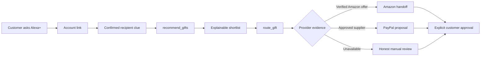
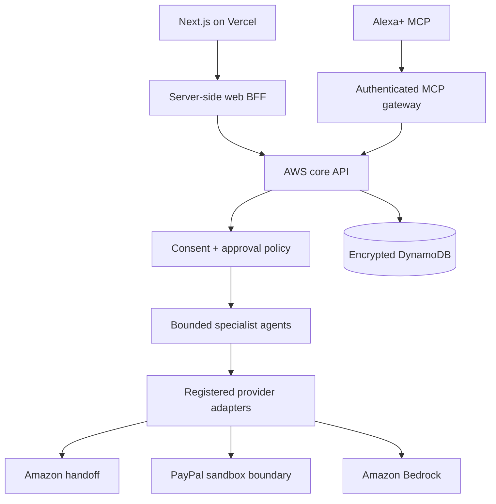

<p align="center">
  
</p>

<h1 align="center">WanderWrap</h1>

<p align="center"><strong>Remember the person. Find the gift.</strong></p>

<p align="center">
  A consent-first gifting companion for Alexa+ and the web.<br />
  WanderWrap turns confirmed clues into explainable ideas, checks a safe fulfilment route, and never purchases without approval.
</p>

<p align="center">
  <a href="#quick-start">Quick start</a> ·
  <a href="docs/WEB_LAUNCH_RUNBOOK.md">Deploy the web app</a> ·
  <a href="docs/ALEXA_PLUS_TEST_PLAN.md">Test Alexa+</a> ·
  <a href="docs/DEMO_SCRIPT.md">Record the demo</a> ·
  <a href="docs/README.md">Documentation</a>
</p>

---

<table>
  <tr>
    <td width="56%">
      <h2>One gifting journey, across channels</h2>
      <p>Ask naturally, confirm what the recipient actually enjoys, receive a short explainable list, and continue only after a delivery and approval check.</p>
      <ul>
        <li><strong>Voice-first:</strong> concise summaries that work without a screen.</li>
        <li><strong>Multimodal:</strong> adaptive MCP App cards for supported Alexa+ surfaces.</li>
        <li><strong>Private by design:</strong> confirmed preference evidence, granular consent and no covert personality profiling.</li>
        <li><strong>Safe commerce:</strong> recommendations and handoffs are distinct from purchases or money movement.</li>
      </ul>
    </td>
    <td width="44%" align="center">
      
    </td>
  </tr>
</table>

## Product surfaces

| Surface | Role | Current state |
|---|---|---|
| Alexa+ MCP add-on | Voice-led discovery, recommendation and fulfilment routing | Server and package implemented; Amazon onboarding and Web Simulator evidence pending |
| Next.js web | Landing page, customer account, connections, gift workspace and authenticated demo | Ready for Vercel deployment |
| AWS core | OAuth, MCP, APIs, DynamoDB, Bedrock boundary and alarms | Development stack deployed in `eu-west-2` |
| Telegram / Messenger / mobile | Future channel adapters over the same journey | Architecture only; not presented as live |

## The demo journey



Nothing in this sequence silently places an order, captures payment, transfers money or exposes a private address.

## Architecture



The website and Alexa+ add-on are separate deployables. They share identity, consent, journey state and provider policies through the AWS core.

## Quick start

Requirements: Node.js 22+, npm and PowerShell for the Lambda packaging helper.

```powershell
npm install
npm run check
npm run test:e2e
npm run demo
```

Then open `http://127.0.0.1:4202/alexa-simulator.html`.

For the Next.js companion:

```powershell
npm run web:dev
```

Copy only empty development placeholders from `.env.example` into an ignored `.env.local`. Never commit credentials or customer data.

## Repository map

```text
apps/web/                 Next.js landing, auth, dashboard, connections and MCP demo
alexa/                    Alexa+ package, MCP App UI and approved media assets
src/                      MCP server, AWS handler, policies, agents and providers
infrastructure/           AWS application and GitHub OIDC CloudFormation
public/                   Local simulator, privacy/terms and frozen preview assets
test/                     Domain, auth, provider, MCP and HTTP end-to-end contracts
docs/                     Product, architecture, launch, testing and demo guides
scripts/                  Repeatable packaging helpers
PROJECT_STATE.md          Durable checkpoint, evidence, blockers and next actions
```

## Deployment status

- Development MCP/API: `https://3eaf282enj.execute-api.eu-west-2.amazonaws.com`
- Protocol: Streamable HTTP MCP `2025-11-25`
- Authentication: Cognito authorization code + PKCE foundation with scoped, resource-bound JWT validation
- Runtime: Lambda, API Gateway, DynamoDB and CloudWatch
- Web host: ready to import into Vercel; domain activation is still pending
- AWS deployment identity: GitHub OIDC restricted to `joboyebisi/WanderWrap:main`

See the [web launch runbook](docs/WEB_LAUNCH_RUNBOOK.md) for the exact Vercel variables, domain sequence and post-deployment customer test.

## Verified today

- `npm run check`: Alexa MCP App build, Next.js production build, AWS handler syntax and 92 automated contracts.
- `npm run test:e2e`: health, simulator delivery, OAuth discovery, bearer/origin enforcement, MCP initialization, tool discovery, recommendation, routing and approval rejection.
- AWS: development health endpoint returns `200`; error and duration alarms are `OK`.

These checks prove application behaviour. They do not claim that Alexa+ onboarding, Amazon catalogue availability, PayPal payment or Xoom transfer is live.

## Documentation

Start at the [documentation index](docs/README.md). The most useful next steps are:

- [Web/Vercel launch](docs/WEB_LAUNCH_RUNBOOK.md)
- [Alexa+ remaining test plan](docs/ALEXA_PLUS_TEST_PLAN.md)
- [Three-minute demo script](docs/DEMO_SCRIPT.md)
- [Product requirements](docs/PRD.md)
- [Technical specification](docs/TECHNICAL_SPEC.md)
- [Live integration gates](docs/LIVE_INTEGRATION_CHECKLIST.md)

## Safety and contribution rules

- Do not commit credentials, access tokens, test-account passwords or private provider responses.
- Keep deployed secrets in AWS Secrets Manager or the hosting platform’s encrypted store.
- Do not describe fixtures, simulated Alexa behaviour or prepared payment payloads as live transactions.
- Run `npm run check` before handing off code; run `npm run test:e2e` whenever MCP, authentication, recommendation, routing, simulator or approval behaviour changes.

See [AGENTS.md](AGENTS.md) and [PROJECT_STATE.md](PROJECT_STATE.md) before making changes.
