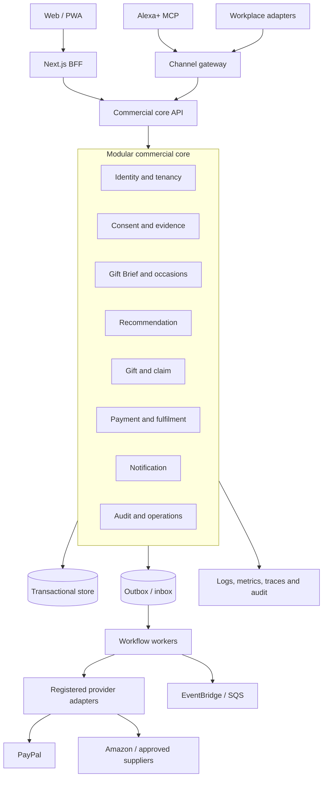

# WanderWrap commercial architecture

**Status:** Target-state decision record
**Date:** 9 November 2026
**Applies to:** Consumer gifting, recipient claims and the shared foundation for business gifting
**Related:** [`PRD.md`](PRD.md), [`TECHNICAL_SPEC.md`](TECHNICAL_SPEC.md), [`IMPLEMENTATION_STATUS.md`](IMPLEMENTATION_STATUS.md), [`LIVE_INTEGRATION_CHECKLIST.md`](LIVE_INTEGRATION_CHECKLIST.md)

This document turns the current Alexa+ and web proof into a commercial product architecture. It describes the intended production shape; it does not claim that unchecked integrations or controls are live. `PROJECT_STATE.md` remains the source of truth for what has actually been verified.

## 1. Commercial launch decision

The first sellable release is one narrow, complete consumer journey:

1. A giver creates a Gift Brief with recipient, occasion, budget, destination and restrictions.
2. WanderWrap produces three explainable, constraint-compliant directions.
3. The giver selects one and explicitly approves a provider action.
4. A verified PayPal merchant payment or an explicitly labelled retailer handoff occurs.
5. WanderWrap creates a single-purpose, expiring recipient claim.
6. The recipient accepts, declines or chooses an allowed alternative without creating an account.
7. Provider events drive fulfilment, reconciliation and the thank-you state.

The launch is not complete if it stops at a recommendation, prepared payment payload or simulated claim. Business campaigns, group contributions, reminders, additional channels and additional suppliers build on this vertical slice after its payment, claim and reconciliation controls are proven.

### Scope tiers

| Tier | Outcome | Included | Explicitly deferred |
|---|---|---|---|
| P0 sellable slice | One giver can fund one gift and one recipient can safely claim it | Gift Brief, recommendation, approval, PayPal merchant checkout, claim, provider events, support/admin visibility | Pooled funds, anonymous cash gifts, multi-provider automatic write failover |
| P1 retention | Customers return and operations scale | Occasions, reminders, saved consented preferences, thank-you, refunds, analytics | Ambient social monitoring and unsupported provider tracking |
| P2 business pilot | A manager can run a governed five-recipient campaign | Organisation tenancy, roles, CSV preview/import, budgets, campaign approval, claims, audit export | General-purpose procurement, escrow and unapproved bulk outreach |
| P3 channel growth | The same journey is available in more places | Alexa+, Slack/Teams/Telegram adapters and mobile notifications | Channel-specific domain forks |

## 2. Architecture principles

1. **Modular monolith first.** Keep one deployable core until scale, compliance or ownership data justifies extraction. Enforce module boundaries in code now so extraction is mechanical later.
2. **State machines over optimistic UI.** Gift, claim, payment and fulfilment each have an authoritative state. A browser redirect or link click never proves payment, delivery or acceptance.
3. **Ports and adapters.** Domain modules depend on typed capabilities, never PayPal, Amazon, Snappy, Bedrock or a channel SDK directly.
4. **Human approval is a domain invariant.** Consequential operations require a short-lived approval bound to actor, tenant, operation, provider, amount, currency, payload hash and idempotency key.
5. **At-least-once delivery, idempotent effects.** Provider webhooks and internal events may repeat. Every consumer uses an inbox/deduplication key; every durable mutation and outbound effect has an idempotency key.
6. **Tenant isolation by construction.** Tenant context comes from verified identity, not request bodies. Every business-owned row, event, cache key, object and log context carries a tenant identifier.
7. **Honest capability state.** `available`, `permission_required`, `degraded`, `unsupported` and `disabled` are different states. Product copy is generated from verified capability state.
8. **Minimise sensitive data.** Store consent receipts and structured preference evidence; avoid retaining raw social text, payment credentials or recipient addresses when a provider can hold them.
9. **Version every boundary.** APIs, events, provider contracts, prompts, models, taxonomies and policy decisions are versioned and observable.
10. **Evolution is evidence-led.** Split a service only for measured independent scaling, security/compliance isolation, deployment cadence or clear team ownership.

## 3. System shape

### Deployment units

| Unit | Responsibility | May contain | Must not contain |
|---|---|---|---|
| Web | Rendering, accessible interaction, session-aware BFF | View models, CSRF/origin enforcement, server-side calls | Provider secrets, ranking policy, payment truth |
| Channel gateway | MCP and future channel translation | Authentication, rate limits, channel rendering | Channel-specific copies of domain workflows |
| Core API | Synchronous commands and queries | Policy, validation, state transitions, transaction boundaries | Long provider waits or unbounded agent loops |
| Workflow worker | Durable asynchronous work | Outbox dispatch, webhook processing, retry/reconciliation | Unreviewed autonomous purchasing or messaging |
| Provider adapter | One external capability | Mapping, authentication, provider verification, normalized errors | Cross-provider business policy |
| Operations surface | Support and risk workflows | Read-only timeline, safe retry/reconcile commands, audit export | Direct database edits or secret display |

The current Next.js, Lambda and DynamoDB implementation can evolve into this shape incrementally. A rewrite is not required.

## 4. Domain boundaries

| Module | Owns | Publishes | Depends on |
|---|---|---|---|
| Identity and tenancy | Users, organisations, memberships, roles, sessions | `MembershipChanged` | Identity provider |
| Consent and evidence | Consent grants, source capabilities, evidence, revocation | `ConsentRevoked`, `EvidenceConfirmed` | Identity and connector adapters |
| Gift Brief | Recipient context, occasion, constraints, budget | `GiftBriefReady` | Consent and evidence |
| Recommendation | Candidate retrieval, hard filters, scoring, explanation provenance | `RecommendationCreated`, `RecommendationSelected` | Catalogue and explanation ports |
| Gift and claim | Gift lifecycle, opaque claim tokens, recipient decisions | `ClaimIssued`, `ClaimAccepted`, `ClaimDeclined` | Identity, approval policy |
| Commerce | Payment intent/order, capture, refund, fulfilment route | `PaymentCompleted`, `PaymentOutcomeUnknown`, `FulfilmentChanged` | Payment and supplier ports |
| Campaign | Business policies, recipients, approval and per-recipient gifts | `CampaignApproved`, `CampaignRecipientFailed` | Tenancy, gift, commerce |
| Notification | Templates, preferences, delivery attempts | `NotificationDelivered`, `NotificationFailed` | Approved email/push/channel ports |
| Audit and operations | Append-only decision timeline and support cases | Operational metrics only | All domain events |

No module reads another module's persistence tables directly. In-process calls use public application services; asynchronous reactions use versioned events.

## 5. Transaction and event model

Use a local database transaction for one aggregate plus its outbox record. A worker publishes the outbox record and marks it dispatched. Consumers persist an inbox key before applying an effect. This avoids pretending that the database and an external provider share a transaction.

Every command envelope contains:

- `commandId`, `correlationId` and optional `causationId`;
- authenticated `actorId`, `tenantId` and effective roles;
- schema version and request timestamp;
- idempotency key for consequential operations;
- approval reference when required.

Every event contains the aggregate ID and version, event type/version, occurrence time, producer and trace context. Events contain references and non-sensitive facts, not access tokens, raw social content, addresses or full provider payloads.

### Payment safety

- Price and currency are resolved from trusted server-side product/configuration data.
- Create and capture have separate idempotency keys and state guards.
- Only a signature-verified provider response or verified webhook can move a payment to `completed`.
- Timeout after dispatch becomes `outcome_unknown`; it never triggers provider failover.
- Reconciliation queries the same sticky provider and raises a support case when it cannot determine the result.
- Refund, cancellation, claim and fulfilment states remain separate, even when one event causes transitions in several aggregates.

### Claim safety

- Store only a keyed hash of a cryptographically random token.
- Bind a claim to one gift, permitted actions, expiry and use count.
- Rate-limit by token fingerprint, IP risk signal and gift; do not log the token.
- Re-authenticate or use an additional challenge for address changes, high-value gifts or suspicious retries.
- Keep marketing consent independent from claim and fulfilment consent.

## 6. Data strategy

### Current and target stores

The existing DynamoDB repositories remain valid for the proven development slice. For the commercial product:

- use Aurora PostgreSQL when relational reporting, organisation roles, campaigns, payment reconciliation and referential constraints become the dominant workload;
- retain DynamoDB for idempotency, short-lived sessions, rate-limit counters or workloads that clearly benefit from keyed access;
- use S3 only for consented assets, redacted exports and immutable evidence bundles;
- keep provider payloads in short-retention encrypted quarantine only when operationally necessary.

The database decision is made with a measured access-pattern review before P0 implementation. Do not run two authoritative stores for the same aggregate.

### Required data controls

- Opaque UUID/ULID identifiers; no email address or provider ID in public URLs.
- Encryption in transit and at rest, with separately scoped KMS keys for production.
- `tenant_id`, creation/update timestamps and optimistic version on tenant-owned records.
- Application authorization on every repository call plus database-level tenant policy where supported.
- Documented retention and deletion rules for each data class.
- Online, backward-compatible schema migrations with an expand/backfill/switch/contract sequence.
- Automated backup, point-in-time recovery and a restore drill with recorded RPO/RTO evidence.

## 7. Identity, authorization and business tenancy

- Cognito remains the customer identity boundary; enterprise federation is added through SAML/OIDC when a pilot requires it.
- The API derives subject, tenant, client, audience and scopes from verified tokens. It never accepts an authoritative `userId`, `tenantId` or role from JSON input.
- Consumer resources use ownership checks. Business resources use organisation membership plus role and policy checks.
- High-impact support access is just-in-time, time-limited, reason-coded and audited.
- Production staff access uses IAM Identity Center, MFA and role assumption; routine root-account access is prohibited.
- Authorization tests include cross-user and cross-tenant negative cases for every resource type.

Initial business roles are `owner`, `admin`, `program_manager`, `organizer`, `contributor`, `viewer` and `support_readonly`. Permissions are explicit capabilities rather than role-name checks scattered through handlers.

## 8. Agent and AI boundary

Agents propose bounded actions. Deterministic application services validate and execute them.

- Each agent has a declared input/output schema, tool allow-list, deadline, retry budget and maximum steps/cost.
- Retrieval includes only evidence allowed for the active subject, purpose and tenant.
- Model output cannot set provider truth, price, availability, delivery, payment or approval state.
- Recommendation records preserve evidence IDs, policy/model versions, candidate set, hard-filter results and final score components.
- Prompt injection, unsupported claims, sensitive inference and data-exfiltration tests are release gates.
- A deterministic or human-review fallback exists for every launch-critical AI step.
- Model/provider changes ship behind flags with shadow or canary evaluation and a tested rollback.

## 9. Security and privacy baseline

P0 requires a maintained threat model covering account takeover, broken object authorization, claim enumeration, webhook forgery/replay, payment duplication, SSRF through catalogue URLs, stored/reflected injection, prompt injection, CSV formula injection, tenant data leakage, secret exposure and support-tool abuse.

Controls include:

- WAF and per-principal/IP/tenant rate limits at public boundaries;
- strict input schemas, size limits, timeouts and output encoding;
- allow-listed outbound hosts and URL normalization for provider content;
- secure headers, HttpOnly/Secure/SameSite cookies and same-origin mutation checks;
- signature verification against the exact raw webhook body before parsing/mutation;
- secret scanning, dependency review, SAST and container/IaC scanning in CI;
- structured redaction at the logger boundary and a test proving prohibited fields never enter logs;
- dependency and base-image patch ownership with a defined critical-fix SLA;
- privacy export, correction, revocation and deletion workflows verified end to end.

A commercial launch also requires legal confirmation of merchant-of-record, tax, refunds, regulated money movement, privacy notices, data-processing agreements and supported countries. Architecture cannot substitute for those decisions.

## 10. Reliability, observability and operations

### Initial service objectives

| Measure | P0 objective | Alerting signal |
|---|---:|---|
| Public API availability | 99.9% monthly | Burn-rate alerts on 5xx/availability |
| Interactive API latency | p95 under 750 ms excluding provider work | Route-level latency histogram |
| Recommendation completion | p95 under 8 s | Workflow duration and failure reason |
| Verified webhook processing | 99% under 60 s | Oldest unprocessed event age |
| Claim page availability | 99.95% monthly | Synthetic claim-view probe |
| Duplicate successful captures/orders | Zero | Reconciliation invariant alert |
| Recovery | RPO at most 15 min; RTO at most 4 h | Backup and restore drill evidence |

Every request and workflow carries a correlation ID. Logs are structured and redacted; metrics describe rates, latency, queue age, state-transition failures and business invariants; traces cross the BFF, core, worker and provider adapter. Audit events are immutable business evidence, not a substitute for operational logs.

The operations inbox must surface `outcome_unknown`, failed webhook verification, exhausted retries, stuck claims, refund exceptions and provider degradation. Each alert has an owner, severity, runbook and safe customer communication template.

## 11. Environments and delivery

Use isolated AWS accounts for development, staging and production, with a separate security/log archive account as the company grows. Vercel preview deployments may use only synthetic data and development services. Staging mirrors production topology and provider sandbox configuration. Production promotion is by immutable artifact digest through GitHub OIDC; no long-lived CI cloud keys.

Configuration is typed, validated at boot and separated from secrets. Secrets live in Secrets Manager or the deployment platform's encrypted store, are scoped per environment/provider and have rotation owners. Feature flags can disable a provider, model, channel or risky journey without redeployment; flags cannot bypass authorization or approval policy.

## 12. Commercial launch gates

P0 cannot be called live until all of the following have environment-specific evidence:

- signup/login/session and account recovery work for a non-administrator customer;
- authorization isolation tests pass across users and tenants;
- consent grant, revocation, export and deletion work end to end;
- a PayPal sandbox order completes approval, server verification, capture and signature-verified webhook processing without duplicate effects;
- rejected, cancelled, duplicate, delayed and outcome-unknown payment paths recover safely;
- an expiring claim can be accepted/declined once, with abuse and accessibility tests;
- fulfilment and thank-you status use provider-authoritative events or explicitly say unavailable;
- observability dashboards, alert routing, reconciliation inbox and support runbooks are exercised;
- backup restoration, rollback and provider/model kill switches are tested;
- privacy, terms, refunds, merchant-of-record, tax and launch-market reviews are signed off;
- the evidence in `LIVE_INTEGRATION_CHECKLIST.md` is updated without credentials or private provider responses.

## 13. Extraction triggers

Do not introduce microservices for aesthetics. Extract a module only when at least one trigger is demonstrated:

- it needs materially different scaling or runtime isolation;
- a compliance boundary requires separate data or network controls;
- a team needs independent deployment and owns the operational burden;
- its release cadence repeatedly blocks the rest of the product;
- measured reliability improves by isolating it.

Payment/webhook processing and isolated model inference are the most likely early candidates. Recommendation, gift and campaign policy should remain together until their boundaries stabilize.

## 14. Immediate build order

1. Freeze the P0 state machines and API/event schemas; add contract fixtures for every failure state.
2. Implement durable consent receipts and revocation propagation.
3. Complete the credentialed PayPal sandbox order/capture/webhook loop with inbox/outbox and reconciliation.
4. Harden recipient claims and build fulfilment/thank-you plus the operations timeline.
5. Add cross-user/tenant security tests, redaction tests, telemetry and alerting.
6. Exercise rollback, restore and incident runbooks in staging.
7. Run the complete commercial launch gate and only then enable a limited UK pilot.
8. Add the five-recipient business campaign on the same gift, claim and commerce primitives.
